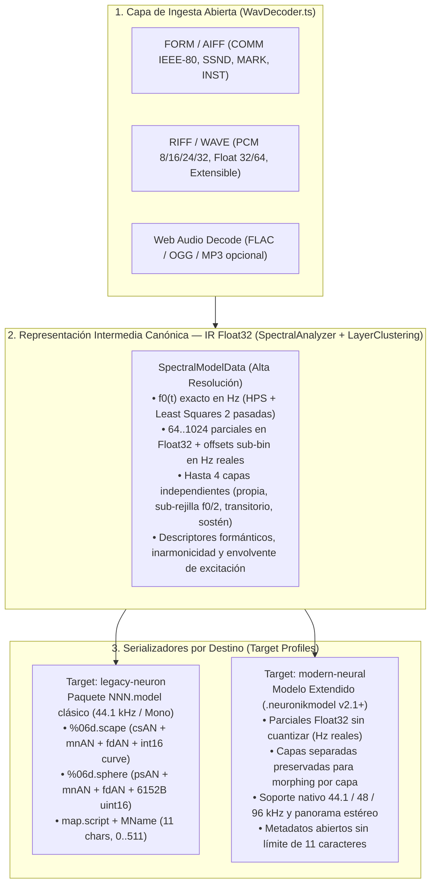

# ABDNeuModMakr -- Arquitectura Dual-Target (Legacy Neuron vs. Modern Neural Synth)

> Documento de diseño arquitectónico y estado de extracción de ingeniería inversa (`NeuronMM_1_2_PC` + `NeuronVS_neurondb`).
> Fecha: **2026-10-26**.

---

## 1. Visión General: ¿Por qué una Arquitectura de Doble Destino (Dual-Target)?

El propósito de **ABDNeuModMakr** no se limita a reemplazar la herramienta antigua de PC/Mac para generar bancos clásicos del hardware Hartmann Neuron (2002) o del plugin `NeuronVS` original. El objetivo final es alimentar una **reinterpretación moderna del sintetizador neuronal (`ABDAxionikVS` / `Axionik`)** que:
1. **Pueda leer y reproducir los bancos antiguos (`000..511.model` / `.sound`)** con fidelidad total.
2. **Supere las limitaciones técnicas de 2002** cuando se creen modelos nuevos (mayor resolución espectral en coma flotante, soporte estéreo espacial, separación real en múltiples capas armónicas/inarmónicas/transitorias, y ausencia de cuantización forzada a `int16`/`uint16` sobre rejilla fija de $44,1\text{ kHz}$).

Para evitar duplicar motores de análisis o quedarnos atrapados en las restricciones de `NASAnalysis.dll`, **ABDNeuModMakr** adopta una arquitectura en **tres capas**:

---

## 2. Comparativa Técnica entre `legacy-neuron` y `modern-neural`

| Dimensión | `legacy-neuron` (Hardware Neuron / NeuronVS 1.x) | `modern-neural` (Nuevo Sintetizador Reinterpretado) | Modo `dual` (Por defecto) |
|---|---|---|---|
| **Frecuencia de muestreo base** | Proyectada siempre a **$44.100\text{ Hz}$** (`periodo = round(44100 / f0)` con clamp $\ge 84$). | **Nativa** ($44,1 / 48 / 88,2 / 96\text{ kHz}$), frecuencias en Hz reales en coma flotante. | Calcula el IR en Hz reales y exporta ambos formatos. |
| **Canales** | **Mono** (`(L + R) * 0.5`). | **Mono o Estéreo** (diferencia de fase/pan por parcial o capa). | Downmix a mono para `.scape`/`.sphere` + estéreo/capas en `.neuronikmodel`. |
| **Representación de Parciales** | Bloque fijo de `6152` bytes por frame (`1024` parciales `uint16`: `freqHz` entero, `amp` `0..65535` ordenado descendente, `bin` sobre paso de $43,066\text{ Hz}$). | Arrays `Float32` continuos (`amplitudes[layer][frame][k]` y `frequencyOffsetsHz[layer][frame][k]` con precisión sub-cent). | Ambos incluidos en `GeneratedModel`. |
| **Bandas Formánticas / Pasadas** | `nb × paso` floats por frame (`nb` $\in \{1, 25, 61\}$, `paso = max(4, nextpow2(stick))`). | Envolvente espectral continua + descriptores por capa (`crest`, `centroid`, `spread`, `duty`, `tilt`). | Ambos incluidos. |
| **Capas Espectrales (Layers)** | **Colapsadas en 1 sola capa plana** al escribir `.sphere`. | **Hasta 4 capas independientes** (`propia`, `entrelazada` en sub-rejilla impar $f_0/2$, cresta transitoria, cuerpo). | Preserva las capas en `.neuronikmodel` y las suma/proyecta para `.sphere`. |
| **Curva de Excitación** | `.scape` con muestras `int16` periódicas a `periodo`. | Excitación/residuo en `Float32` sin pérdida de agudos por clamp de `periodo >= 84`. | Ambos incluidos. |
| **Identidad y Límites** | Slot `0..511`, `MName` máx. `11` chars ASCII, `ParameterSet` `0..9` con tablas cerradas `mnAN` (A/B). | Slot compatible + UUID, nombre completo, etiquetas semánticas y matriz de modulación abierta. | Ambos incluidos. |

---

## 3. ¿Qué está YA extraído vs. qué falta en `NeuronMM_1_2_PC`? (Estado ~85 %)

Antes de programar al 100 % el empaquetador bit-exacto de la **Fase 2**, conviene tener claro qué partes de la ingeniería inversa en `C:\Users\ajaba\Downloads\neuron\NeuronMM_1_2_PC` están **cerradas y verificadas al 100 %** y cuáles siguen **abiertas (~15 %)** en la descompilación de `NASAnalysis.dll`:

### 3.1 Lo que YA está 100 % verificado y cerrado (Listo para usar)
1. **Desempaquetado completo del ejecutable (`MODELmaker_1_2.exe`)**:
   - Stub `jexepack` destripado, los 51 ficheros extraídos (`tmp/jexe/z/`), todas las clases Java (`neuronapp.*`) desensambladas (`javap`) y `NASAnalysis.dll` (118 KB) abierta en Ghidra/REA.
2. **Frontera JNI y validaciones de entrada (`FUN_10009b20`)**:
   - Los 4 puntos de entrada JNI (`validateSample`, `initNAS`, `analyseSample`, `cancelAnalysis`), la estructura de 16 campos `SampleInfo`, los códigos de retorno `0..13` y la tabla `complexityToRecDepth = [1, 4, 8, 12, 16, 24, 32, 42, 54, 64]`.
3. **Gramática de contenedores `.scape` y `.sphere` verificada sobre los 3.134 ficheros reales (`Models/000..511`)**:
   - Cabecera `csAN:100` de `.scape` (`v=256`, `id`, `periodo`, `0`, `len`, `loopStart`, `loopEnd`, `0`).
   - Cabecera `psAN:140` de `.sphere` (`ver` $\in \{272, 288\}$, `id`, `cnt = parameterSet`, `periodo`, `nvalid = nsamp/1024 - 3`, `stick = recursionDepth`, `psum == paso == max(4, nextpow2(stick))`, `nb == nb2` $\in \{1, 25, 61\}$, `psize = 6152`, `u1/u2 = round(loop/1024)`, y `6 floats @ +0x50` = `3 × (freqHz, amp)` ganadores globales).
   - Tamaño exacto de cada frame de `.sphere`: `step = 16 + nb * paso * 4 + 6152` bytes (verificado en 1.565 de 1.567 esferas de fábrica).
   - Los **20 mapas de nombres `mnAN` (10 para `.scape` y 10 para `.sphere`)** de los Parameter Sets `0..9` sobre las tablas A (`0x100154d0`, 91 nombres) y B (`0x10015938`, 73 nombres), con 0 variación intra-caso en los 3.134 ficheros.
4. **Formato de `map.script`, `MName`, sesiones serializadas y transferencia FTP**:
   - `KeyZoneData.formatForMapScript`, convención de nombres `NC_HARTMANN = "name_rrr_lll_v"`, fichero `MName` y estructura de directorio `<NNN>.model/`.

### 3.2 Lo que FALTA por cerrar en la descompilación (~15 % pendiente en `NASAnalysis.dll`)
1. **El callback serializador byte a byte de la tabla de bloques (`FUN_1000ff10` → `param_1[0xf]`)**:
   - Sabemos **qué** escribe en disco (porque hemos parseado los 3.134 ficheros reales), pero falta cruzar el código exacto del callback en la DLL que vuelca los histogramas de votos al bloque de `fdAN` y a la tabla `bands[nb][paso]` de cada frame.
2. **Mapeo exacto Histograma de Votos → Valores de `fdAN` y `bands[nb][paso]`**:
   - En `FUN_10009cf0` hay un histograma de pitch (`+0xb4308`) y 3 histogramas de parciales (`+0xdf41c`, `+0xe341c`, `+0xe741c`). Falta documentar la fórmula exacta con la que esos acumuladores rellenan los 6 pares de floats de `fdAN` (en los casos en que no son plantilla fija) y los `nb × paso` floats que preceden al banco de 6152 bytes.
3. **Condición runtime `nb = 25` vs `nb = 61`**:
   - En modo draft (`parameterSet == 9`), `nb = 1`. En modo normal (`0..8`), la mayoría de las zonas usan `nb = 25`, pero algunas zonas sueltas dan `nb = 61`. Es una condición de convergencia en tiempo de ejecución dentro de `FUN_10009cf0` que aún está pendiente de aislar.
4. **Constantes globales `DAT_10015xxx` inicializadas en runtime (`DllMain` / constructores estáticos)** y coeficientes del banco de 100 filtros (`DAT_1003f984`, `FUN_100074b0`).

---

## 4. Estrategia de Desarrollo Recomendada

Dado este estado (~85 % extraído):
- **Lo que SÍ dejamos ya listo y cerrado en código (Fase 1 + base Dual-Target)**:
  - La interfaz `ProcessConfig` con soporte explícito de `targetFormat?: 'dual' | 'legacy-neuron' | 'modern-neural'`.
  - El pipeline espectral completo en coma flotante (`WavDecoder`, `FftEngine`, `SpectralAnalyzer`, `LayerClustering`, `GridIndicator`, `ScapeSphereGenerator`, `WebAudioPipeline`) que ya genera tanto el modelo moderno multi-capa (`.neuronikmodel` v2.1) como los contenedores `.scape`/`.sphere`/`map.script` con la geometría real verificada (`step = 16 + nb * paso * 4 + 6152`, `cnt`, `periodo`, `stick`, `psum`, `paso`, `nb`).
- **Lo que posponemos hasta que termine el 15 % restante de `NASAnalysis.dll` (Fase 2B)**:
  - No merece la pena codificar a ciegas la heurística exacta de llenado de `fdAN` votado ni la condición `25 vs 61` de `nb` hasta que se extraiga el callback `param_1[0xf]` de `FUN_1000ff10` y el banco de filtros `FUN_100074b0` en `NeuronMM_1_2_PC`.
  - Mientras tanto, podemos avanzar en paralelo en los lectores de bancos existentes (**Fase 2A: Reader de `.scape`/`.sphere`/`map.script` reales de `NeuronDB`**) o en la interfaz y flujo de ficheros (**Fase 3 y Fase 4**), que no dependen de ese 15 % interno de la DLL.
